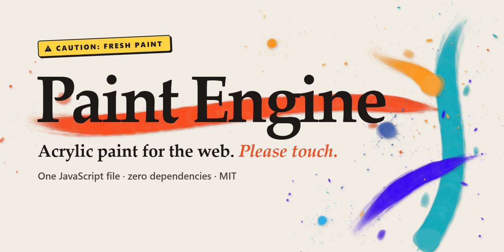
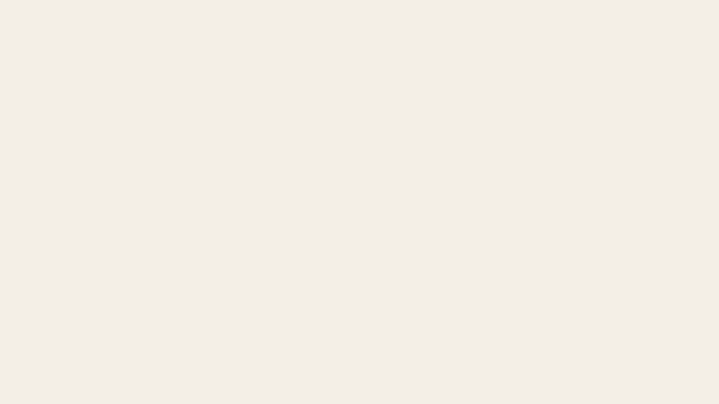
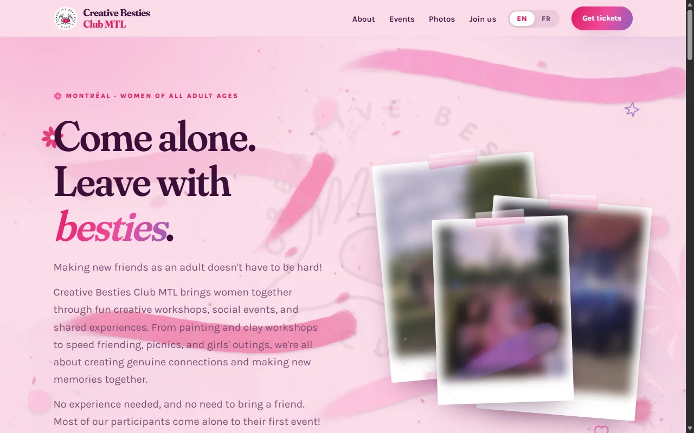

<h1 align="center">
  <a href="https://alexandrewillame.github.io/paint-engine/"></a>
</h1>

<p align="center">
  <b>Drags become brush strokes. Taps become splatters.</b><br>
  A procedural acrylic paint engine for the web, in one JavaScript file with zero dependencies.
</p>

<p align="center">
  <a href="https://alexandrewillame.github.io/paint-engine/"><b>Live demo</b></a> ·
  <a href="https://alexandrewillame.github.io/paint-engine/demo/playground.html">Playground</a> ·
  <a href="#quick-start">Quick start</a> ·
  <a href="#api">API</a> ·
  <a href="#recipes">Recipes</a> ·
  <a href="https://creativebestiesclubmtl.com/">In the wild</a>
</p>

<p align="center">
  
  
  
</p>

---

Paint Engine renders mouse, touch and pen input as acrylic paint on a `<canvas>`. A stroke's width
and dryness follow the pointer's speed (wide and dense when slow, narrower and streaky when fast),
the speed at release decides how it ends (rounded, throwing droplets, or a tapered tail), and a tap
leaves a splatter. There are no brush images or presets: marks are stamped from small
sprites generated at startup. Every random choice comes from a seed, so the same input and seed give
the same pixels; without a seed, each mark gets a random one.

It was written for the website of [Creative Besties Club MTL](https://creativebestiesclubmtl.com/),
which uses it on every page.

**[Try it in your browser →](https://alexandrewillame.github.io/paint-engine/)** The whole demo site is
wet: drag anywhere.

<p align="center">
  <a href="https://alexandrewillame.github.io/paint-engine/"></a>
</p>

## Features

- **One file, no dependencies.** 45 KB minified, about 17 KB gzipped. Works as a classic `<script>`
  (global `PaintEngine`, even on a page opened from disk), an ES module (`paint-engine.mjs`) or
  CommonJS; TypeScript types in `paint-engine.d.ts`. No build step.
- **Canvas 2D only.** No WebGL, no image or font files. Marks are stamped with normal alpha blending,
  so overlapping paint gets darker; each mark casts a soft shadow from its own alpha.
- **Seeded marks.** Marks are stored as recipes (path, colour, seed), and re-rendering a recipe gives
  the same pixels. `undo()`, `resize()` and replays are built on that, and a painting can be saved as
  a few kilobytes of numbers.
- **Bounded work per frame.** The stroke in progress is drawn incrementally with a per-frame dab cap;
  finished strokes are rendered in 3 to 8 ms slices between frames; history is capped at 150 marks by
  default.
- **Input.** `mount()` reads Pointer Events (mouse, touch, pen, coalesced samples). Points are filtered
  for jitter, smoothed with a spline and resampled at even spacing, so strokes don't depend on the
  device's event rate or pixel density.
- **Three entry points.** `mount()` makes an element paintable, `paintPage()` lets visitors paint the
  whole page or one element of it (under the content or blended over it), and `paintStroke()` paints
  from code along any path.

## Demos

Every demo is a single HTML file: open it, then view the source.

| | |
|---|---|
| [**Playground**](https://alexandrewillame.github.io/paint-engine/demo/playground.html) | A full-page canvas with palettes, undo, replay, PNG export, and share-by-link (the strokes are encoded in the URL). |
| [**Paint the page**](https://alexandrewillame.github.io/paint-engine/) | The demo site itself: `paintPage()` under the content of a long scrolling page. |
| [**Brush highlights**](https://alexandrewillame.github.io/paint-engine/demo/highlights.html) | Underlines, highlights and circles fitted to words with `paintStroke()`, drawn when the text scrolls into view. |
| [**Splat buttons**](https://alexandrewillame.github.io/paint-engine/demo/splats.html) | Splatters as feedback on a like button, a form submit and a game target, plus a paint trail behind the pointer. |
| [**Seeded paintings**](https://alexandrewillame.github.io/paint-engine/demo/generative.html) | Paintings generated from a numeric seed, applied to avatars (seeded by user ID) and post covers (by post ID). |
| [**Coloring book**](https://alexandrewillame.github.io/paint-engine/demo/coloring.html) | An SVG line drawing over a `mount()` canvas, with the brush scaled to the sheet. |
| [**Paint to reveal**](https://alexandrewillame.github.io/paint-engine/demo/reveal.html) | The painted pixels used as a mask over hidden content, scratch-card style. |
| [**Drop-in for any page**](https://alexandrewillame.github.io/paint-engine/demo/drop-in.html) | `paintPage({ layer: 'over' })` on an existing page: paint blended over the content, no CSS changes. |
| [**Paint one section**](https://alexandrewillame.github.io/paint-engine/demo/hero-only.html) | `paintPage({ area: '.hero' })`: painting limited to one element, under its content. |

Other uses: a 404 page visitors can paint on, a paint trail behind the cursor, generated
placeholders and covers, hit marks in a canvas game. Built something with it? Open an issue with a
link.

## Quick start

`paint-engine.js` is the whole library. Everything else in this repository is optional:

| | |
|---|---|
| `paint-engine.js` | **the library**: a plain script, the only file you need |
| `paint-engine.mjs` | a small wrapper for `import { mount } from './paint-engine.mjs'` (keep it next to `paint-engine.js`) |
| `paint-engine.d.ts` | TypeScript types |
| `index.html`, `demo/` | the demo site (what GitHub Pages serves) |

Load it from a CDN (or [download `paint-engine.js`](paint-engine.js) and host it yourself):

```html
<div id="art" style="height: 400px"></div>

<script src="https://cdn.jsdelivr.net/gh/alexandrewillame/paint-engine@v1.0.1/paint-engine.js"></script>
<script>
  const paint = PaintEngine.mount('#art');
</script>
```

That's a canvas you can paint on with mouse, finger or pen, kept at the size of `#art`.
For a minified copy, ask jsDelivr for `paint-engine.min.js` instead (it minifies on the fly).

**Let visitors paint your whole page**, with the paint under your text:

```html
<script src="https://cdn.jsdelivr.net/gh/alexandrewillame/paint-engine@v1.0.1/paint-engine.js"></script>
<script>
  PaintEngine.paintPage({ palette: ['#EE4C9B', '#8B5FBF', '#F6A6C8'] });
</script>
```

(Put it at the end of `<body>`. If your sections paint solid backgrounds, see
[Paint under your content](#paint-under-your-content), or use `layer: 'over'`.)

**Or only one section**, say the hero, and the rest of the page stays clean:

```js
PaintEngine.paintPage({ area: '.hero' });
```

**Paint from code:**

```js
const paint = PaintEngine.mount('#art', { input: false });
await PaintEngine.paintStroke(paint, [[40, 200], [300, 120], [560, 220]], {
  speed: 700, flick: true, color: '#17A6B5', animate: true,
});
paint.splat(480, 90, { color: '#F04E23' });
```

**ES modules / bundlers / npm.** `paint-engine.mjs` is the ES-module entry:

```js
import { mount, paintStroke } from './paint-engine.mjs';
// or, once published to npm: import { mount } from 'paint-engine';
```

## API

Coordinates are CSS pixels relative to the canvas. Times are milliseconds on any clock: only the
differences matter, and they are what tells a slow stroke from a fast one.

### `PaintEngine.mount(element, options?)` → engine

Makes an element paintable: creates a canvas filling it (the element becomes `position: relative` if
it was static), keeps it at the element's size, and wires mouse, touch and pen input, one stroke at
a time. `element` is an element or a selector. Returns the engine (below) plus:

| | |
|---|---|
| `paint.canvas` | the canvas it created |
| `paint.color` | colour of the next strokes: a string, a function returning one, or `null` to pick from the palette. Settable at any time. |
| `paint.destroy()` | removes the canvas and listeners |

Options: everything `createPaintEngine` takes (except `canvas`), plus `color` and `input` (`false`
for an element painted only from code).

### `PaintEngine.paintPage(options?)` → page

Lets visitors paint on the whole page: every drag leaves a stroke, every tap a splatter, and the paint
stays where it landed as the page scrolls. Touch scrolling keeps working: a vertical swipe that scrolls
the page reads as a tap, a drag that doesn't scroll spreads into a stroke.

| Option | Default | |
|---|---|---|
| `area` | the whole page | an element or selector to paint instead, e.g. `'.hero'`: marks start only inside it and stay clipped to it. It becomes `position: relative` (if static) and `isolation: isolate`, so with `'under'` the paint lies on the section's own background, under its content. |
| `layer` | `'under'` | `'under'`: beneath your content, text stays on top. `'over'`: above everything, blended. |
| `opacity` | `0.4` under, `0.6` over | of the paint layer |
| `blend` | none under, `'multiply'` over | its CSS `mix-blend-mode` |
| `zIndex` | `-1` under, `2147483000` over | |
| `palette`, `seed`, `scale` | | as in `createPaintEngine` |
| `ignore` | form fields, `[contenteditable]`, `[data-paint-engine-ignore]` | selector of elements a gesture can't start a mark on |
| `mouse`, `touch` | `true` | turn either input off (both off: paint only from code) |
| `selectText` | `false` | let mouse drags select text as well as paint |
| `dpr` | from the device | raster resolution, lowered automatically on weak hardware |

Returns `{ engine, layer, splat(pageX, pageY, opts), stroke(points, opts), clear(), destroy() }`.
`splat` and `stroke` paint from code in page coordinates (CSS px from the top-left of the document).

### `PaintEngine.paintStroke(engine, points, options?)` → `Promise`

Paints one stroke along a path, the way a brush dragged along it would. `points` are `[x, y]` pairs or
`{x, y}` objects; they are walked at the given speed and sampled like a 120 Hz pointer.

| Option | Default | |
|---|---|---|
| `speed` | `500` | CSS px per second. Slow is wide and wet; around 900 and up it's narrow and dry. |
| `endSpeed` | `speed` | speed at the release. Below ~790: a rounded end. ~790–920: thrown droplets. Above: a flicked tail. |
| `flick` | `false` | shorthand for an `endSpeed` fast enough for a full tail |
| `color`, `seed` | from the engine | same points + colour + seed = same pixels |
| `animate` | `false` | `true` paints in real time; a number plays that many times faster |

A single point is a tap: a splat.

### `PaintEngine.createPaintEngine(options)` → engine

The engine itself, for when you handle input yourself.

| Option | Default | |
|---|---|---|
| `canvas` | required | the canvas to paint on |
| `palette` | 6 colours | colours to pick from when a mark has none |
| `seed` | `Date.now()` | seeds the brush sprites, paper grain and every random choice |
| `paper` | `true` | `false` leaves untouched pixels transparent (for overlays) |
| `scale` | `1` | brush size: `0.5` paints marks half as big |
| `dpr` | `devicePixelRatio` | backing-store resolution (capped at 2) |
| `budget` | `{ maxMarks: 150 }` | history size; past it the oldest marks are dropped |

| Method | |
|---|---|
| `beginStroke(x, y, t, { color, seed }?)` | start a stroke |
| `extendStroke(x, y, t)` | add a point (feed every pointer event; `getCoalescedEvents()` helps) |
| `endStroke(t)` | finish it. A stroke that never moved more than a few px is a tap: it splats. |
| `splat(x, y, { size, color, seed }?)` | a splatter, `size` in CSS px |
| `undo()` | remove the last finished mark (returns `false` if none) |
| `flush()` | finish background baking now, so the canvas is final (before `toBlob()`) |
| `resize(width, height)` | set the size in CSS px; the history is repainted |
| `clear()` | wipe everything |
| `setBudget({ maxMarks, maxInkArea })` | change the history bounds |
| `adoptPixels(image, x, y)` | draw finished pixels into the painting (no history: `resize`/`undo` drop them) |
| `markCount`, `drawing` | marks in the history; whether a stroke is in progress |

A minimal input loop:

```js
const paint = PaintEngine.createPaintEngine({ canvas });
paint.resize(canvas.clientWidth, canvas.clientHeight);
canvas.style.touchAction = 'none';
canvas.addEventListener('pointerdown', (e) => paint.beginStroke(e.offsetX, e.offsetY, e.timeStamp));
canvas.addEventListener('pointermove', (e) => { if (e.buttons) paint.extendStroke(e.offsetX, e.offsetY, e.timeStamp); });
canvas.addEventListener('pointerup', (e) => paint.endStroke(e.timeStamp));
```

`PaintEngine.makeRNG(seed)` is the engine's seeded random generator (`makeRNG('hello')()` returns the
same number everywhere). The lower-level pure functions (`resampleByArcLength`, `splatDabSpecs`,
`strokeMarks`…) are exported too, for tools and experiments; the comments in the source describe them.

## Recipes

### Paint under your content

With `paintPage({ layer: 'under' })` the paint sits at `z-index: -1`, above the page's own background
and below everything else. So it only shows where nothing paints a solid background over it. If a
section or card has its own background, move that background to a pseudo-element one level lower:

```css
.card { position: relative; }            /* no background here */
.card::before {
  content: ""; position: absolute; inset: 0; z-index: -2;
  background: white; border-radius: inherit;
}
```

Paint now runs across the card, and the card's text stays on top. This only works while nothing
between the card and the root creates a stacking context (`transform`, `opacity` < 1, `filter`, a
`z-index` on a positioned ancestor…). When that's impractical, `layer: 'over'` blends the paint over
everything instead, with no CSS changes.

The page's own background is `<body>`'s, drawn by the browser beneath everything. If `<html>` gets a
background too, as dark-mode extensions such as Dark Reader give it, `<body>`'s background becomes
an ordinary block over the paint; `paintPage()` detects that and sets `isolation: isolate` on
`<body>`, which puts the paint back between that background and the content.

### Sideways strokes on phones

By default a sideways drag on a touch screen belongs to the browser: Chrome on Android can even read
one that starts near the edge as its swipe-back gesture. On a page people paint on, keep vertical
scrolling and pinch-zoom for the browser and leave sideways drags to the paint:

```css
body { touch-action: pan-y pinch-zoom; }
```

(Horizontally scrolling elements inside the page keep working: they decide their own scrolling.)

### Pick the colour

```js
const paint = PaintEngine.mount('#art', { palette: ['#264653', '#2A9D8F', '#E9C46A'] });
paint.color = '#E76F51';   // every new stroke in this colour
paint.color = null;        // back to picking from the palette
```

### Save as an image

```js
paint.flush();             // finish anything still baking
paint.canvas.toBlob((blob) => { /* download or upload it */ }, 'image/png');
```

### Brush size

`scale` multiplies how big marks are, not how they behave: `0.5` is a brush half as wide for small
text or small canvases; `1.5` for a big one. It is fixed per engine; use two engines (two stacked
canvases) for two sizes.

### Replay, share and the same painting everywhere

Every random choice comes from a seed. Give the engine a `seed`, and each stroke a `color` and a
`seed`, record the points you feed it, and feeding them again repaints the same picture: that's how
the Playground's undo, replay and share-as-a-link work (see its source). Recorded points are tiny:
the share link holds a whole painting in a few kilobytes.

### React, Vue, Svelte…

Create in an effect, destroy on cleanup:

```jsx
useEffect(() => {
  const paint = PaintEngine.mount(ref.current);
  return () => paint.destroy();
}, []);
```

The file touches no DOM until you create an engine, so importing it during server rendering is safe.

### Performance

- Each engine keeps four canvases its own size. For huge canvases, lower `dpr`.
- The default history (`maxMarks: 150`) keeps memory and `resize()`/`undo()` cost bounded; past it,
  the oldest marks are dropped. `paintPage()` turns the budget off because it keeps finished paint as
  pixels instead.
- Many small engines are fine (the highlights demo uses one per highlight), but each builds its
  brush sprites on creation (a few milliseconds), so create them when they're needed.

## How it works

1. **Smoothing.** Raw pointer samples go through a [One Euro filter](https://gery.casiez.net/1euro/)
   (an adaptive low-pass filter: it removes jitter at low speed without adding lag at high speed), a
   Catmull-Rom spline, and arc-length resampling, then get a frame
   (tangent, normal, speed) at every step. The resampler is incremental and exactly equal to a
   one-shot run, so the live preview and the final bake agree pixel for pixel.
2. **Dabs.** A pool of irregular procedural sprites (soft and crisp, with mip levels) is generated at
   start-up. Every mark is stamped from them with ordinary alpha: a body fill for a clean silhouette,
   texture dabs, bristle streaks on fixed lanes, a two-line sheen, speckle and droplets off the
   flanks.
3. **Gestures.** Width and dryness follow speed. The touchdown frays. A slow release rounds off; a
   fast one carries the stroke on past the finger as a tapering tail that breaks into flecks. Short
   drags blend into splashes; taps are splatters (core, tendrils, satellites, speckle).
4. **Baking.** Finished marks are stored as recipes (seed, colour, centreline) and drawn in time
   slices between frames, with a soft shadow cast from their own alpha. A per-frame dab budget sheds
   speckle before streaks before structure; a bounded history keeps memory flat and can replay
   everything on resize.

The source is commented throughout, section by section, if you want the details.

## Browser support

Any current browser: Chrome, Edge, Firefox, Safari, on desktop and mobile. The soft cast shadow uses
the canvas `filter` property; browsers without it still paint, without the blur. The Playground's
share links use `CompressionStream` where available.

## In the wild

<a href="https://creativebestiesclubmtl.com/"></a>

**[Creative Besties Club MTL](https://creativebestiesclubmtl.com/)**: drags paint the page, taps
leave splatters, and the photos can be painted on.

Using Paint Engine somewhere? Open an issue with a link and I'll add it here.

## Contributing

Bug reports, ideas and demos are welcome: open an [issue](https://github.com/alexandrewillame/paint-engine/issues)
(there are templates), or see [CONTRIBUTING](.github/CONTRIBUTING.md) before a pull request. Please
follow the [code of conduct](.github/CODE_OF_CONDUCT.md).

## License

[MIT](LICENSE) © 2026 Alexandre Willame. Free for personal and commercial use.
